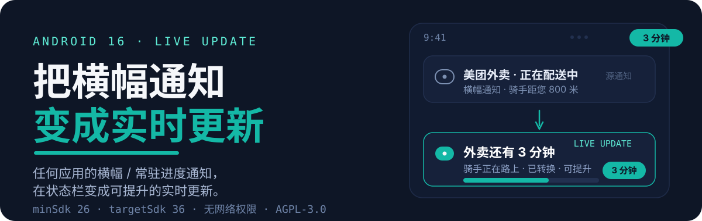
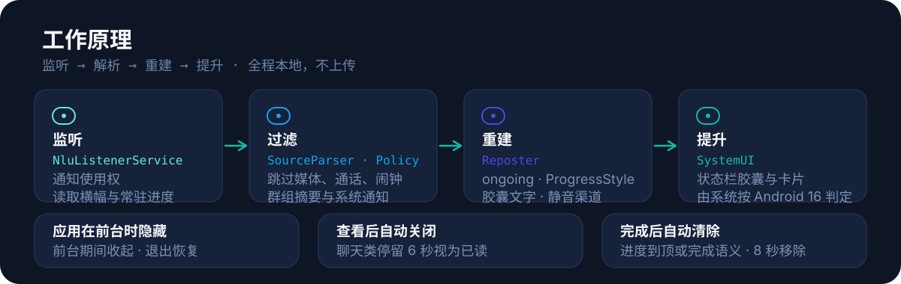

# Notification 2 Live Update

> 任意应用的**横幅 / 常驻进度通知** → Android 16 状态栏 **Live Update（实时更新）**。
> 纯本地运行：监听通知 → 解析内容 → 以本应用身份重新发布。不联网、不上传、不需要 root。

<p align="center">
  
</p>

<p align="center">
  <a href="https://github.com/AndyerNotFound/Notification2LiveUpdate/releases/latest"><b>⬇️ 下载最新 APK</b></a>
</p>

[](https://github.com/AndyerNotFound/Notification2LiveUpdate/actions/workflows/android.yml)
[](LICENSE)

---

## 它是什么

把外卖、打车、下载、导航、录音等应用的**横幅通知或常驻进度通知**，转换成 Android 16 的 **Live Update** 形态：状态栏胶囊 + 实时更新卡片。

Android 不允许应用直接把自己标记为「提升」。本应用做的事情是把通知**重新包装**成可提升的形态——常驻、进度样式、胶囊文字——再交给系统按 Android 16 的规则判定。

## 工作原理

<p align="center">
  
</p>

- **监听**：通过通知使用权读取其他应用的通知（`NluListenerService`）。
- **过滤**：解析标题 / 正文 / 进度 / 计时器；跳过媒体、通话、闹钟、系统通知与群组摘要。
- **重建**：以本应用身份发布——`ongoing`、`Notification.ProgressStyle`、短关键文本、静音渠道。
- **提升**：交给 SystemUI 判定；Android 16 QPR1 起通过 `POST_PROMOTED_NOTIFICATIONS` 权限 + 显式请求。

## 主要功能

- **横幅 → Live Update**：进度、计时器、大图标与源通知对齐，源通知更新即原地刷新。
- **胶囊文字**：自动 / 百分比 / 应用名 / 标题，最多 7 个字符。
- **原通知按钮**：把源通知自带的动作（回复 / 暂停 / 取消等）连同图标和 `PendingIntent` 原样转发到实时更新上，最多 2 个，另留 1 个「忽略」。
- **触发规则**：仅横幅 / 横幅 + 常驻进度 / 全部通知。
- **按应用选择**：默认只转换勾选的应用，也可以对所有应用生效。
- **应用在前台时隐藏**：打开源应用时收起实时更新，退出后自动恢复。
- **查看后自动关闭**：在聊天类应用停留 6 秒视为已读，直接移除。
- **完成后自动清除**：进度到顶或出现完成语义（如「已送达」「计时结束」），8 秒后自动移除；源通知被点掉 / 划掉时立即同步移除。
- **替换原始通知**（可选）：转换成功后移除源通知，避免通知栏出现两份内容。
- **忽略动作**：通知自带「忽略」按钮，30 分钟内不再转换该条。
- **诊断 + 一键测试**：权限、资格、判定模式一目了然，内置约 20 秒演示通知。

## 系统要求

| 项目 | 要求 |
| --- | --- |
| 系统 | Android 8.0 (API 26) 以上可安装；**Live Update 形态需要 Android 16 (API 36)** |
| 权限 | 通知使用权 + 通知权限；「前台隐藏」「查看后自动关闭」另需「使用情况访问」（特殊权限，需手动授予） |
| Root / Shizuku | 不需要 |

在 Android 16 以下，转换结果会退化为普通常驻进度通知，不会进入实时更新区。

## 安装

1. 从 [Releases](https://github.com/AndyerNotFound/Notification2LiveUpdate/releases/latest) 下载最新 APK。
2. 校验（每个 Release 附带 `SHA256SUMS.txt`）：

```bash
sha256sum -c SHA256SUMS.txt
```

3. 首次打开按提示完成授权：

   1. **通知使用权**：「系统状态 → 去授权」→ 在系统列表里允许本应用；
   2. **通知权限**：「系统状态 → 允许」；
   3. **使用情况访问**（推荐）：「系统状态 → 去授权」，否则「前台隐藏 / 查看后自动关闭」不生效。

4. 打开右上角总开关 → 选择转换范围 → 点「发送测试 Live Update」验证。

> 0.3.0 起 CI 使用**固定签名密钥**，之后版本可直接覆盖安装；v0.1.0 / v0.2.0 升级需先卸载一次。
>
> 签名证书 SHA-256：`F5:7F:0B:36:0B:07:56:63:3A:10:CC:4C:30:9C:61:F4:48:C9:01:03:74:35:01:BA:1A:D5:FD:15:FC:A6:41:4F`

## 实时更新资格

Android 16 前后有两套提升规则。本应用不写死版本号：启动时构造一条探测通知调用 `hasPromotableCharacteristics()`，由系统自己告诉我们当前生效的是哪套，再按对应模式组装：

| | Android 16.0（API 36.0） | Android 16 QPR1（36.1+） |
| --- | --- | --- |
| 判定方式 | 通知特征达标即提升（须彩色 + 进度样式） | manifest 声明权限 + 显式请求（**不能彩色**） |
| 用户开关 | 无开关，完全由系统判定 | 系统设置里可按应用开关 |
| 本应用模式 | 旧版彩色模式（`setColorized`） | QPR1 请求模式（`EXTRA_REQUEST_PROMOTED_ONGOING`） |

首页「实时更新资格」显示当前**判定模式**与系统是否允许；「去开启」跳转对应系统页（只有 QPR1 设备有开关页，36.0 设备由系统自动判定）。

## 已知限制

- **提升由系统决定**：即使特征齐全，渠道设置、勿扰模式或 OEM 额外策略仍可能不提升，此时退化为普通常驻通知。
- **点击卡片只打开源应用主入口**：动作按钮会原样转发，但点击通知本体的深层页面无法复制。
- **动作按钮依赖标准 `Notification.Action`**：纯 `RemoteViews` 自定义通知没有可转发的按钮，整条通知也会被跳过；内联回复（`RemoteInput`）能否回填取决于源应用与 ROM，未做真机验证前可先关掉「转发原通知按钮」。
- **闹钟 / 通话 / 媒体 / 系统通知默认不转换**：这些分类在过滤阶段就被跳过，因此不会出现「闹钟响完了卡片还挂着」的情况，但也意味着它们本身不会变成 Live Update。
- **完成 / 已读判定是启发式的**：完成只认「进度到顶」与常见关键字（完成 / 已送达 / 计时结束 / completed / delivered 等），「完成率 30%」「已完成 3/10」不会误判；已读靠「源应用前台停留 ≥ 6 秒」推断，不是真实回执。
- **不同 OEM 行为不同**：HyperOS / ColorOS / One UI 对常驻通知与实时通知有自己的策略。

## 常见问题

**Q：状态栏没有胶囊？**
先看「实时更新资格」是否为绿；再看「最近转换」是否显示「已转换 · 可提升」。资格为否时点「去开启」，在系统设置中允许本应用使用实时更新。

**Q：消息点开看过了，实时更新还挂着？**
0.7.0 起有三条清理路径：点掉 / 划掉源通知时，系统会回报 `REASON_CLICK` / `REASON_CANCEL` / `REASON_CANCEL_ALL`，卡片立即同步移除；源应用撤回通知时，只要「源通知消失后保留」是关闭的也会立即移除；源通知一直不清时，在该应用里停留 6 秒后自动移除（需要「使用情况访问」）。只有「保留」开启、且源通知是被应用而不是被你撤回时，卡片才会继续留着。

**Q：为什么有的横幅没被转换？**
默认只转换「横幅」或「横幅 + 常驻进度」。聊天类通知常是群组摘要或媒体样式，会被过滤；可把触发时机切到「全部通知」再试。

**Q：卸载重装后通知使用权没了？**
Android 会在卸载时撤销该权限，重新授权即可。

## 构建

要求：JDK 21、Android SDK Platform 36、Gradle 8.14.6（仓库自带 wrapper）。

```bash
./gradlew assembleDebug
# 产物：app/build/outputs/apk/debug/app-debug.apk
```

CI 通过 GitHub Actions 构建：固定签名密钥存于 Secrets（环境变量注入，未设置时回退 AGP 自动生成的 debug 签名），推送 `v*` 标签时自动构建并发布 Release（含 `SHA256SUMS.txt`）。

## 目录结构

```text
app/src/main/java/com/andyer/n2lu/
├── N2LuApp.kt            入口：日志与通知渠道
├── data/                 Prefs（Compose 状态 + 磁盘）、EventLog
├── service/              监听、解析、重建、演示、完成 / 已读策略
├── ui/                   Compose 界面
└── util/                 系统状态、前台应用检测、应用列表
assets/readme/            README 视觉素材（SVG）
```

## 许可

基于 [AGPL-3.0](LICENSE) 发布。
